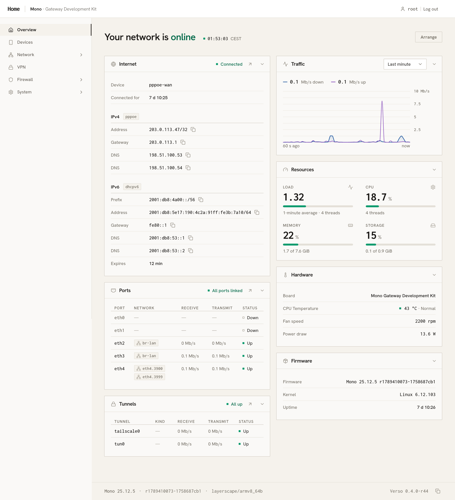

# Verso

A modern web interface for your OpenWrt router, in place of LuCI.

> **Verso is experimental.** Back up your router's configuration before you install it.



## Requirements

- A router running **OpenWrt 25.12 or newer**, with at least **128 MB of storage**.
- A way to type commands on it: run `ssh root@192.168.1.1` on your computer.

Check that Verso is built for your router:

```sh
apk --print-arch
```

It must print `aarch64_generic` or `x86_64`; Verso has no packages for other architectures.

## Install

Copy these three lines into the router's terminal:

```sh
wget -O /etc/apk/keys/verso.pem https://sysupgrade.mono.si/verso/verso.pem
echo "https://sysupgrade.mono.si/verso/$(apk --print-arch)/packages.adb" > /etc/apk/repositories.d/verso.list
apk update && apk add verso
```

The first line trusts Verso's packages, the second adds where they come from, and the third installs Verso.

## Open it

Go to **https://192.168.1.1** in your browser (your router's address, if you changed it). If LuCI is installed too, Verso is at **https://192.168.1.1:8443** instead.

Your browser will warn that the connection isn't private: the router made its own certificate. Continue to the site, then sign in as `root` with your router's password.

## Add more

Optional pages, each its own package:

```sh
apk add verso-plugin-dnsdhcp   # DNS and DHCP
apk add verso-plugin-qos       # Speed limits and schedules per device
apk add verso-plugin-vpn       # VPN
apk add verso-plugin-ddns      # Dynamic DNS
apk add verso-i18n-base-sl     # Slovenian
```

## Update

Updates Verso and its add-ons, and nothing else on the router:

```sh
apk update && apk upgrade $(apk info | grep '^verso')
```

## Remove

```sh
apk del $(apk info | grep '^verso')
```

## Help and feedback

Report bugs and ideas as [GitHub issues](https://github.com/we-are-mono/verso/issues).

## For developers

- [How Verso is built](docs/architecture.md): the plugin model, the architecture and the repository layout.
- [Contributing](CONTRIBUTING.md): how we work, and how to build, test and run Verso.
- [Writing a plugin](docs/plugins.md)
- [Building and packaging](docs/building.md)
- [Design system](DESIGN.md) and [decisions](docs/ADR/)

## License

GPL-2.0-only, the same license as OpenWrt. See [LICENSE](LICENSE).
